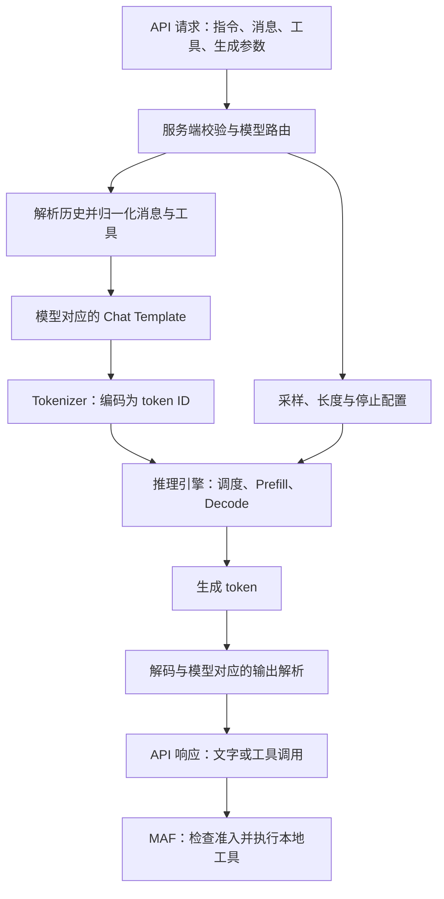

# 从 API 字段到模型输入与推理

状态：助手根据公开资料整理，待本人复述与实验。查阅日期：2026-11-16。本文以常见的纯文本、自回归 Transformer 推理服务为例，不声称复原了 OpenAI、Magpie 或当前 GLM 模型服务的内部实现。

关联：[工具声明与历史上下文](04-budgets-and-termination.md#工具声明与历史上下文有什么区别)、[个人问题与认识变化](../reflections/001-tool-call-budget.md)。

## 三句话解释

API 字段先由服务端解释，消息、指令和工具描述按目标模型的格式组织，再编码成 token ID。推理引擎用模型权重计算下一 token 的分布，结合采样与停止条件生成输出。服务端将输出解析为文字或结构化工具调用，实际本地工具仍由 Agent 运行时执行。

## 处理链路



这是逻辑分层，步骤可以位于同一进程，也可以拆成前端与 GPU 服务，不要求每条箭头都经过 HTTP。vLLM 的 [Renderer APIs](https://docs.vllm.ai/en/latest/serving/online_serving/renderer/) 公开展示了将渲染、分词和输出解析与 token 输入、token 输出的引擎分离的方案；这提供可查证的实例，不代表当前项目已部署 vLLM。

## 哪些字段组成上下文，哪些控制执行

| 输入 | 常见处理方向 |
| --- | --- |
| 指令、消息、历史工具结果 | 解析、归一化后参与模型上下文构造 |
| tools 中的函数名称、描述和参数 schema | 交给支持工具的模板编码，必要时还用于构造输出约束 |
| temperature、top_p、输出 token 上限 | 转为采样与停止配置，不必写成提示词文字 |
| model | 选择模型、tokenizer 和相应配置 |
| stream | 控制结果如何持续传回，不等于额外的模型对话轮次 |

工具选择和结构化输出策略可以同时影响模板与解码约束，不能把所有请求字段都理解为“拼到一个长字符串里”。这里是常见处理方式，具体支持范围仍由服务实现决定。

## Chat Template 怎样组织工具

Chat Template 是与模型训练格式相匹配的序列化规则，常见公开实现使用 Jinja。它接收消息和可选工具声明，安排角色标记、正文、工具描述、历史结果与 assistant 生成起点。模板负责结构，tokenizer 负责把这种表示编码为模型词表中的 ID。两步可以通过一个 API 完成，例如 Transformers 的 `apply_chat_template(..., tokenize=True)`。[Hugging Face 文档](https://huggingface.co/docs/transformers/main/chat_templating)

一个已查看的具体例子是 [Qwen2.5-7B-Instruct 的 tokenizer_config.json](https://huggingface.co/Qwen/Qwen2.5-7B-Instruct/blob/main/tokenizer_config.json)。其 chat_template 在有 tools 时创建开头的 system 段，写入系统指令和工具说明，再遍历消息；生成时可在末尾追加 assistant 起始标记。

下面只是根据模板结构手写的简化示意，省略了真实说明文字和完整 schema，未运行模板渲染：

```text
<|im_start|>system
你是研发学习助手。
工具说明：GetServiceHealth，参数为 serviceId……
<|im_end|>
<|im_start|>user
查询 order-api 的状态。
<|im_end|>
<|im_start|>assistant
```

这个例子表明，API 层独立的 tools 确实可以在服务端编码进 system 段；两层描述并不矛盾。它也说明工具不必位于上下文最后。该模板还将工具结果包装进自己的对话格式，不能假设 HTTP 中的每个 role 都在最终序列里保持原样。

角色标记与正文都参与模型输入，但不是所有可见标记都必然对应单独的特殊 token。模型学习的是与训练匹配的格式；擅自改变模板可能影响效果。角色和格式也不能替代应用的权限、预算或业务校验。

## 推理引擎实际做什么

对于上述文本路径，前端通常向引擎提供 token ID、采样配置和请求元数据；引擎内部组织张量、位置及注意力所需信息，调用模型计算。

1. **Prefill**：处理输入序列，计算各层表示和可复用的注意力 KV，得到后续生成所需状态及首个输出的分布。已有前缀缓存时可以复用部分计算，不必总从头处理全部输入。
2. **Decode**：根据输出分布选取 token，将新 token 和已有状态用于下一步计算，继续生成直到结束标记或执行上限。

实际引擎会使用批处理、分块预填充等调度方式，不等于逐个用户请求独占 GPU；推测解码等优化也可能改变一次执行产生 token 的方式。这里解释逻辑依赖，不规定物理执行必须一次只生成一个 token。vLLM 的 [优化说明](https://docs.vllm.ai/en/latest/configuration/optimization/#chunked-prefill) 展示了 prefill 与 decode 工作如何一起调度。

推理引擎可以接收并管理结构化控制信息，但模型前向计算本身不会按 HTTP 的 messages、tools 属性名直接调用业务函数。对于多模态模型，还会有图像、音频等额外特征或编码器路径，不能把本文的纯文本图当成所有模型的完整输入结构。

## 输出怎样变回 tool call

支持工具的模型可以生成符合其训练格式的函数名与参数表示；服务端的输出解析器据此构造 API 的 tool_calls 或 function_call 项。有些配置还会约束解码格式。vLLM 提供模型对应的工具解析器，并区分普通与流式解析。[工具调用文档](https://docs.vllm.ai/en/latest/features/tool_calling/)

对于本项目的本地函数，返回调用请求之后，MAF 才依据工具注册、参数、预算等执行 ServiceTools，然后把结果交回下一次模型请求。输出解析成了合法结构，不代表参数合理、得到授权或工具已经执行成功。

## 反例与复习问题

反例：同一份 OpenAI 兼容 JSON 可以由不同模型模板渲染成不同序列；观察 API 请求，只能证明客户端提供了哪些字段，不能证明工具说明最终处于模型输入末尾。

待做的小实验：选定模型与 tokenizer 版本，用相同 messages，分别提供 tools 和空工具列表，以 `tokenize=False` 查看渲染差异。验收应确认工具说明的插入位置、消息保留情况与 assistant 起点；再通过 `tokenize=True` 观察 token ID。此实验未执行，也不能单凭模板渲染验证模型一定正确调用工具。

失败实验候选：在副本中去掉模板对 tools 的处理，确认请求虽然带了声明，渲染文本却没有相应工具说明。该实验只验证这一模板的输入构造，不代表所有服务都通过同一种文本模板传递工具。

复述：为什么 tools 在 HTTP 中没有 System 角色，却可能出现在模型的 system 段？为什么 temperature 不一定写进提示？服务端返回 tool_calls 时，业务工具究竟执行了没有？

## 证据边界与后续定位

本次阅读 Hugging Face main 文档、Qwen 官方模型文件页面和 vLLM latest 文档；未在本地安装或运行这些组件，未下载模型权重、生成 token、执行渲染实验或抓取 Magpie 请求。Qwen 页面显示文件最近修改提交 `acbd96531cda22292a3ceaa67e984955d3965282`；固定提交的 raw/blob 链接本次未被浏览工具成功读取，模板内容依据当次可访问的 main 文件页，不冒充已验证固定版本下载。

若后续要定位当前 GLM 服务的真实链路，需要先确定 Magpie 路由到的后端，再核对后端模型版本、模板、tokenizer 和输出解析配置。当前模型别名本身不足以推出这些细节。
